| Subject | Max Kirchstein |
| --- | --- |
| **Alias** | Occam's Razer |
| **Activity** | Builds websites and apps, mostly in TypeScript |
| **Last seen** | [maxkirchstein.com](https://maxkirchstein.com) |

## Statement from the subject

# HAX THE WORLD

## Evidence

**Exhibit A: [Portfolio](https://maxkirchstein.com)**  
Recovered at the scene: a Swiss four-column grid, with type as the hero and scroll-driven motion.  
`Next.js` `Tailwind CSS` `GSAP` `Lenis`

**Exhibit B: [C$ @ black box](https://cmoney-concerts.vercel.app)**  
The site for C$'s album listening session. One static page, about 110 KB including the font. Investigators found nothing left to cut.  
`Astro` `Tailwind CSS` `GSAP`

**Exhibit C: Still**  
A meditation and emotional-wellness app, set in an illustrated world that changes with the hour, season and weather. Still under investigation.  
`Expo` `React Native` `Reanimated`

## Known associates

`TypeScript` `Next.js` `Astro` `React Native` `Tailwind CSS` `GSAP` `Python` `Java`

## Sealed records

Request access to the private repositories

 
Request denied. ████ ██████ ███ ████████.

